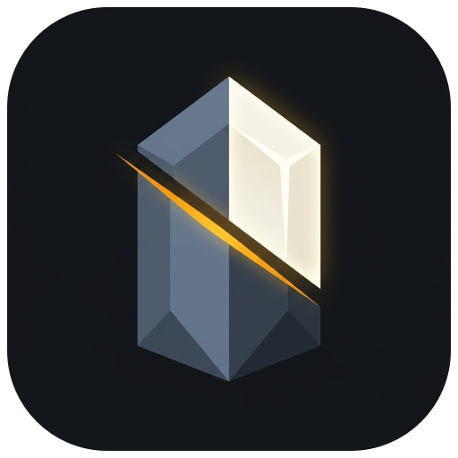

<p align="center">
  
</p>

<h1 align="center">Sculpting Framework</h1>

<p align="center">
  <strong>Turn rough problems into aligned, scoped, implementation-ready vertical slices.</strong><br/>
  An end-to-end, tool-agnostic AI agent plugin &amp; skill set for Product Engineers.
</p>

<p align="center">
  <code>v1.0.1</code><!-- x-release-please-version --> &nbsp;&middot;&nbsp; <a href="LICENSE">MIT License</a> &nbsp;&middot;&nbsp; <code>SKILL.md</code> &amp; <code>MCP</code>
</p>

---

## Why Sculpting?

AI coding assistants and spec-driven dev tools already handle writing code, TDD, and code reviews. For modern **Product Engineers**, the real bottleneck is everything **before** the first commit:

- Framing the right problem before jumping to solutions
- Asking the right stakeholder the right 3 questions at the right time
- Cutting scope ruthlessly (**Hard No-Go** vs. **Deferred**) without losing alignment
- Closing technical/compliance unknowns *before* sprint planning
- Handling real-world chaos: delayed decisions, mid-flight pivots, 1-week P0 pauses, and owner handoffs

Like sculpting a block of stone, software delivery is not waterfall — it is **progressive resolution**. **Sculpting** guides you and your AI agent from raw block to polished release in four crisp stages, without AI slop or enterprise ceremony.

```text
  [ Raw Idea / Problem ]
            │
            ▼   1. BLOCK       — Problem without solution words, cost of inaction,
            │                    Template 1 Async Discovery Pings, Living State Card
            ▼   2. ROUGH CUT   — Realistic options (Anti-Strawman), No-Go vs. Deferred,
            │                    Pre-Detail Spike (Template 5), Vendor/DPA Gate,
            │                    Business Rules (Template 3) & Sign-off Lock (Template 2)
            ▼   3. DETAIL      — Codebase-grounded contracts, Vertical Slices (Template 4),
            │                    Conflict-free parallelism & 1-line capacity confirmations
            ▼   4. POLISH      — Handoff to coding/TDD/review skills, No-Go scope brake,
                                 progressive rollout, release comms & impact closure
```

---

## Key Features

- **Zero Bureaucracy on Small Tasks (`Fast-Track`):** ≤2-day, single-service micro-features skip heavy templates and move in **1 async turn** (3 questions + 1-line No-Go → single ticket → build).
- **Anti-Slop & Anti-Over-Engineering:** Zero framework jargon in outgoing team messages. No strawman options just to fill tables.
- **Minimal Recovery Protocol (1 Card + 2 Rules):**
  - **Living State Card:** A single 10–15 line SSoT pinned at the top of your doc for instant post-pause catch-up and cold owner handoffs.
  - **Assumption + Expiry:** Unblock delayed stakeholders on *no-regret* work while locking irreversible investments.
  - **Delta & Sign-off Reset:** Handle pivots, 5+ day pauses, or owner handoffs with a concise delta — never rewrite the RFC.
- **Tool-Agnostic Core:** Works with MCP-connected tools (Notion, Linear, Jira, Slack, GitHub), webhooks/CLI, or plain manual handoffs via a one-time **Context Layer**.
- **Empirically Stress-Tested:** Validated across **7 multi-agent simulations** covering cross-team billing, SSO/RBAC compliance, GDPR data residency, chaos disruptions, veto deadlocks, 1-day micro-features, and an A/B regression test ([see validation log](docs/simulations.md)).

---

## Included Skills

| Skill | Stage | Responsibility |
| :--- | :--- | :--- |
| **`sculpting`** | Orchestrator | First-time Context Layer onboarding, Triage, Fast-Track, Minimal Recovery Protocol, and stage routing |
| **`sculpting-block`** | Stage 1 — Block | Solution-free problem framing, Living State Card initialization, and Template 1 Async Discovery Pings |
| **`sculpting-rough-cut`** | Stage 2 — Rough Cut | Realistic options, Hard No-Go vs. Deferred, Vendor/DPA gate, Pre-Detail Spike (Template 5), Templates 2 & 3, and 25-min Meeting Fallback |
| **`sculpting-detail`** | Stage 3 — Detail | Codebase-grounded contracts, Template 4 Vertical Slices, single-owner parallelism check, and 1-line capacity confirmations |
| **`sculpting-polish`** | Stage 4 — Polish | Handoff to coding/review skills, No-Go scope brake, rollout/telemetry verification, release comms, and impact closure |

---

## Installation

Sculpting follows the open **`SKILL.md`** and marketplace plugin standards, so it works out of the box across major AI coding environments.

### Antigravity
Clone or copy this repository into your Antigravity plugins directory:
```bash
git clone https://github.com/mskasal/sculpting-framework.git ~/.gemini/config/plugins/sculpting-framework
```
*(Antigravity reads the root `plugin.json`, `assets/icon.png`, and `skills/*/SKILL.md` automatically.)*

### Claude Code
Install directly as a Claude Code plugin marketplace repository:
```bash
/plugin marketplace add mskasal/sculpting-framework
/plugin install sculpting-framework@sculpting-framework-marketplace
```

### Cursor / Codex / Other `SKILL.md` Agents
Install via `skills` CLI or copy the `skills/` directory into `.cursor/skills/` or `.claude/skills/`:
```bash
npx skills add mskasal/sculpting-framework
```

---

## Quick Start

1. **Start a new feature:**
   > *"Let's sculpt a new feature: enterprise customers need Net-30 invoicing with EU VAT reverse-charge."*
2. On your first run, **`sculpting`** asks 4 quick questions to create your workspace **Context Layer** (`sculpting.context.md`) — team owners, veto holders, escalation owner, tool adapters, and red lines.
3. The agent automatically triages the work into **Fast-Track** or **Block → Rough Cut → Detail → Polish** and guides you through each gate.

---

## Documentation
- [Sculpting Framework v1.0 Specification](docs/framework-v1.0.md)
- [Empirical Validation Log (7 Simulations)](docs/simulations.md)

## License
[MIT](LICENSE) — created by [Samed Kasal](https://github.com/mskasal).
